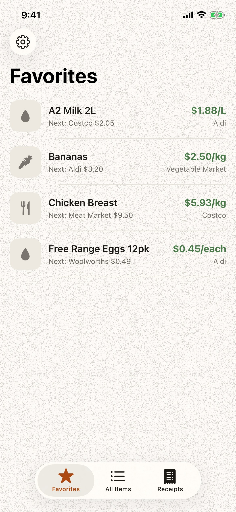
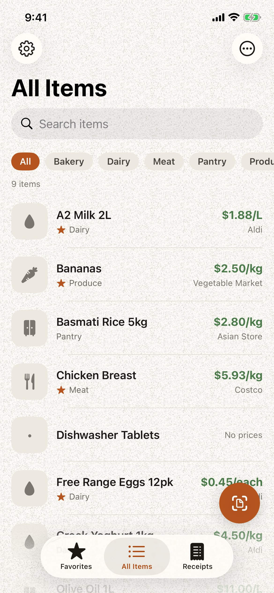
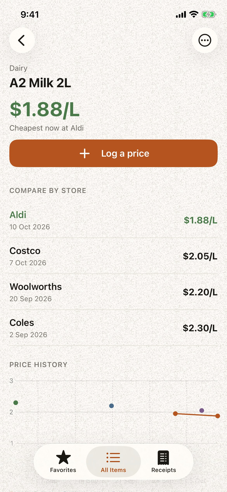
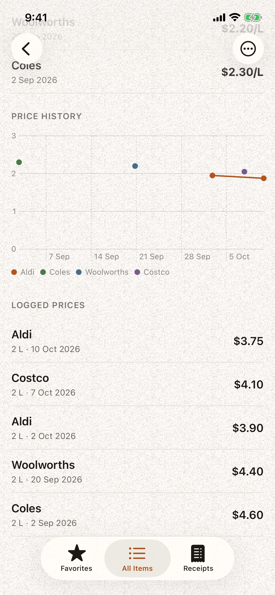
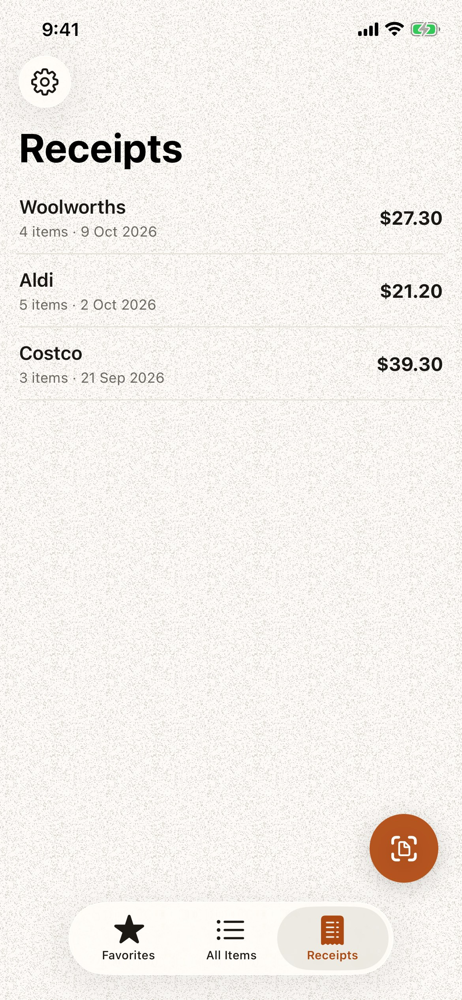
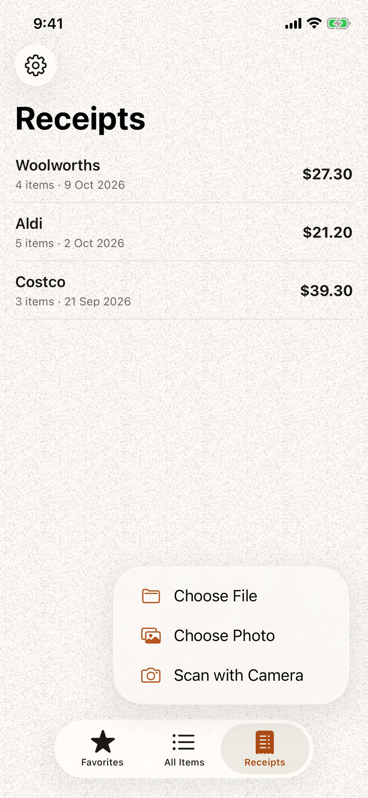

# PriceTrack

Scan grocery receipts, itemise them, and see which store (Aldi, Coles, Woolworths, Costco, and the markets) is actually cheapest per item — by unit price, not just sticker price. Favourite the items you care about (A2 milk, eggs, etc.) to keep them front and centre.

  
  
  

  
  
  

*(Screenshots use fictional sample data, not real receipts.)*

## How it works

- **Scan** — the floating button on All Items and Receipts opens *Scan with Camera*, *Choose Photo* or *Choose File* (a photo, screenshot or PDF). On-device Vision OCR reads the text and you tap each line to assign it to an item, price, quantity, and unit — deliberately "OCR + confirm", since receipt layouts vary a lot between stores. Add a Claude API key under the gear button (**Smart Scan**) and items, prices and quantities are read for you instead, so you only confirm; if it ever fails, scanning falls back to on-device reading with a note.
- **From outside the app** — send a receipt to PriceTrack from the Share Sheet, or open one from Files or Mail with *Open In*; it goes through the same scan-and-confirm flow.
- **Favorites** — your starred items as a calm list: the cheapest current store (by unit price) in green, with the next-cheapest underneath.
- **All Items** — every item you've ever logged, searchable and filterable by category (auto-suggested from the item name, always editable). Swipe or long-press an item to favourite or delete it; the **⋯** menu has *Select items* for multi-select delete.
- **Item detail** — the cheapest unit price and store up front, a **Log a price** button for manual entries, a per-store comparison, a price history chart with a line per store (once there are a few points), and the raw list of logged prices (swipe to delete).
- **Receipts** — every scan grouped as one shop, so you can see — or undo — a whole receipt at once, with its photo and total.
